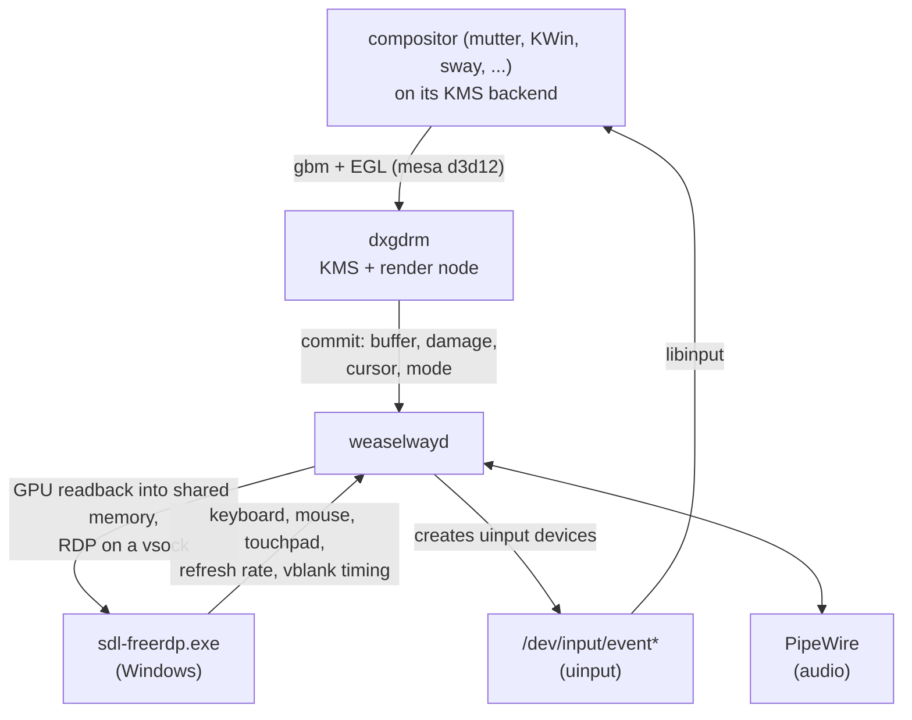

# Weaselway reference

This document describes how weaselway is put together: the path a frame takes, where each component
comes from, what the NixOS module configures and why, and how to build and debug the image. It is
for people who work on weaselway. For installation and day-to-day use, see the [README](README.md).

## Architecture

<!-- IMAGE: optional. If the Mermaid diagram below renders too small on GitHub,
     export it as an SVG (docs/images/frame-path.svg) and link that instead. -->



The compositor runs on its regular KMS (kernel mode setting, the Linux interface for driving
displays) backend and has no knowledge of Windows. dxgdrm is a kernel module that presents a virtual
display: one CRTC (the display controller that scans a buffer out), a primary plane with
`FB_DAMAGE_CLIPS` (the changed rectangles of each frame), a cursor plane with a hotspot, and one
connector.

The scanout buffers are D3D12 textures. weaselwayd waits for a commit on the dxgdrm node and imports
the buffer into its own GL context (mesa d3d12). It reads the damaged region back into a pixel
buffer, with a compute shader where the context has OpenGL ES 3.1 and with `glReadPixels` otherwise
([0007](docs/adr/0007-damage-readback-paced-by-the-client.md)). It then copies the pixels into a
gfxredir buffer (the frame format of WSLg's RDP extension) in the shared memory that the Windows
client maps. The client opens that memory as a Direct3D 12 heap and copies the damaged rectangles
on the GPU into the texture it draws. Layouts it cannot open that way go through a CPU copy.

weaselwayd acknowledges a frame to dxgdrm before it issues the readback, unless the previous
readback is still running or the client holds every buffer. dxgdrm withholds the compositor's
page-flip event until then, and completes it on its next virtual vblank. A slow client therefore
slows the compositor down, and frames do not queue up.

The client's keyboard, mouse and touchpad become uinput devices (input devices created from user
space), which libinput handles like any others. The size of the session follows the viewer's window:
weaselwayd sets the mode on dxgdrm, and the compositor sees a hotplug event. The viewer has its own
channel, `Weaselway::Display`, on which it reports two things about the monitor the window is on:

- its refresh rate, which weaselwayd uses as the mode's rate
  ([0029](docs/adr/0029-refresh-rate-from-the-viewer.md));
- how long before that monitor's vblank each frame was ready. weaselwayd shifts dxgdrm's vblank to
  keep this at about 3 ms ([0031](docs/adr/0031-vblank-phase-from-the-viewer.md)).

While no compositor owns the display, the client gets a screen with "No compositor running". While
the compositor has the display off, it gets "Screen is off"
([0026](docs/adr/0026-placeholder-without-a-compositor.md)).

The clipboard is the only feature that needs the compositor's cooperation, and there is no protocol
for it that every compositor implements. weaselwayd runs two backends and uses the one that finds
its compositor:

- With mutter, it uses the D-Bus interface that gnome-remote-desktop uses
  (`org.gnome.Mutter.RemoteDesktop`). It creates a session object with the clipboard enabled and
  never starts it, so gnome-shell shows no screen-sharing indicator.
- With KWin and the wlroots compositors, it is a Wayland client with `ext-data-control-v1`. It
  watches `$XDG_RUNTIME_DIR` for `wayland-*` sockets and connects to the first compositor that
  offers the protocol. mutter does not offer it and is left alone.

Text, HTML and images are converted between Windows clipboard formats and MIME types.

A KMS compositor needs a logind session on `seat0` that owns the devices. `ww-start-session` creates
one by running the compositor in a transient system unit with a PAM (the Linux login framework)
session, as a display manager would.

## Components

The NixOS image takes everything from the flake.

| Component | Source | Where it runs |
|---|---|---|
| mesa with the d3d12 changes | `weaselway/mesa`, branch `mesa-26.2.6-wsl` | user distro (`/run/opengl-driver`) |
| dxgdrm kernel module | `weaselway/dxgdrm` flake | user distro kernel, loaded from the store |
| weaselwayd | [weaselwayd/](weaselwayd) in this repo | user distro, as a unit of the user manager |
| mutter | nixpkgs, plus [one patch](nix/mutter-stage-relayout.patch) | user distro (gnome-shell links it) |
| KWin (optional) | nixpkgs, plus a damage patch per release | user distro |
| aquamarine, Hyprland (optional) | nixpkgs, plus one patch each | user distro |
| Windows viewer `sdl-freerdp.exe` | `weaselway/freerdp` flake, `packages.sdl-freerdp` | Windows, started from the store through interop |

[ubuntu/install.sh](ubuntu/install.sh) sets up the same session on Ubuntu 26.04, see
[Ubuntu](#ubuntu).

### The shared-memory share

WSL creates the `wslg` shared-memory device only when GUI applications are enabled, which is the
default (`guiApplications` in `.wslconfig`). The device is virtiofs (a file system shared between
the VM and Windows) with DAX (direct mapping of the host's memory), and nothing in the guest can
create it. The frames are handed over through it. Without the share, weaselwayd logs "the
shared-memory share is not mounted" and exits.

WSL's system distro keeps running its own Weston and PulseAudio next to the session. Weston
allocates on the same share and takes its RDP connection on a socket that WSL hands it, so neither
interferes with weaselwayd.

### Values the guest derives

| Value | Source |
|---|---|
| vsock port | fixed: `WEASELWAY_VSOCK_PORT=3389` |
| VM ID | `wslinfo --vm-id -n` |
| shared-memory NT path for the client | `WSL\<VM ID, upper case, no braces>\wslg` |
| virtiofs tag | always `wslg` |

A vsock is a socket between the VM and Windows. The port is set in
[environment.d/10-weaselway.conf](environment.d/10-weaselway.conf). NixOS-WSL has no
`/bin/wslinfo`, so `ww-start-viewer` falls back to `exec -a wslinfo /init --vm-id -n` when
`wslinfo` is not on the `PATH`.

`prep-session.sh` mounts the share at `/run/wsl/virtiofs-mounts/weaselway-wslg`, private, with
`/mnt/wslg-shared-memory` a link to it. The mount is private because WSL unmounts other virtiofs
mounts when the first `wsl.exe` of the other elevation starts.

### Compositor patches

A compositor needs no patch to run on the virtual display. The patches the image carries fix
problems that show up there but are unrelated to RDP:

- mutter: the overview keeps its old size when the stage is resized, which happens whenever the
  viewer's window is resized. The fix is the single commit on `main` of `weaselway/mutter`.
- KWin: it told the kernel that the whole buffer changed, so every frame was read back in full. The
  patch sets `FB_DAMAGE_CLIPS`. It is on `master` of `weaselway/kde-kwin`, with backports on
  `weaselway-6.6.6` and `weaselway-6.7.5`. The overlay picks the patch for KWin 6.6, 6.7 or 6.8
  from `nix/kwin-*-fb-damage-clips.patch`.
- aquamarine and Hyprland: Hyprland kept the size it started with, because aquamarine ignored new
  modes of a connector that stays connected, and Hyprland tested a larger mode with the last frame's
  smaller buffer, which dxgdrm rejects. The fixes are commits on `main` of `weaselway/aquamarine`
  and `weaselway/Hyprland` ([0030](docs/adr/0030-hyprland-follows-the-window-size.md)). No image
  includes Hyprland. The patches apply when a configuration enables it.

## Repositories

- **weaselway** (this repository): the flake, the NixOS modules, the overlay, the image
  configuration, weaselwayd, the shell scripts and the Ubuntu install script.
- **mesa**: the image builds the branch `mesa-26.2.6-wsl` with nixpkgs' Mesa package definition.
  `main` carries the same commits on top of upstream main. The image builds it instead once
  nixpkgs' Mesa is 27 or newer, because nixpkgs' package only builds the Mesa major it targets. The
  commits change d3d12 and dzn (Mesa's Vulkan driver on D3D12):
  - scanout buffers on the dxgdrm KMS node, with a GEM handle (the kernel's buffer handle) and a
    linear modifier, and dma-bufs between d3d12 processes through their shared handles;
  - fences exported as sync_files and DRM syncobjs through dxgdrm, and dzn presenting through
    dma-bufs;
  - dxgkrnl context priorities ([0033](docs/adr/0033-gpu-priority-through-dxgkrnl-contexts.md))
    and write-back upload heaps on GPUs that share memory with the CPU;
  - the driver's compiled pipeline states in the Mesa shader cache, off on NVIDIA, whose driver
    crashes when asked for them. `MESA_D3D12_PSO_CACHE=0` or `1` overrides the default;
  - fixes for Chromium, Firefox, dma-buf export to GTK 4 and Intel's video driver.
- **dxgdrm**: `main`. It builds against the kernel trees from wsl-kernel. `dxgdrm_drm.h` in that
  repository is the interface that weaselwayd and mesa use.
- **wsl-kernel**: `main`. It provides the prepared WSL kernel trees and `mkModules`, which dxgdrm
  and the Bluetooth modules are built with. The trees use the toolchain the WSL kernel itself is
  built with, the kernel.org crosstool gcc 13.2.0 with binutils 2.41, because the kernel sets
  `CONFIG_MODVERSIONS` (symbol checksums) and rejects a module built with nixpkgs' gcc. The
  configure phase compares the regenerated `.config` with the captured one. References to the
  kernel tree are stripped from the modules; they would add about 1.6 GiB to the image. wsl-kernel
  pins its own nixpkgs, so nixpkgs updates do not rebuild the trees.
- **freerdp**: `main`. Its flake provides a Windows cross-compilation dev shell and
  `packages.sdl-freerdp`, which runs `build-freerdp.sh` with the SDL3, SDL3_ttf and OpenSSL archives
  fetched by Nix beforehand. Versions and hashes are read from the script. The commits change the
  SDL3 client:
  - a Direct3D 11 presenter on a render thread, which copies gfxredir buffers on the GPU through a
    Direct3D 12 heap on the shared memory (`-sdl-zero-copy` turns that off);
  - the `wwdisplay` channel, which reports the monitor's refresh rate and the vblank timing;
  - touchpad gestures, Alt+F4 sent to the session, and the signed 16-bit PCM fix.
- **mutter**: `main` is upstream main plus the relayout fix, kept in a form that can be submitted
  upstream. The image does not build the fork. It applies the same commit to nixpkgs' mutter as a
  patch. The `*-wslg` branches contain the retired RDP backend, from which weaselwayd's RDP and audio
  code was ported.
- **kde-kwin**, **aquamarine** and **Hyprland**: see [Compositor patches](#compositor-patches). The
  image applies the backports as patches.
- **NixOS-WSL**: upstream, used unmodified as a flake input.

## Flake layout

### Inputs

- `nixpkgs` (nixos-26.05) and `nixpkgs-unstable` (nixos-unstable), in one lock
  ([0032](docs/adr/0032-stable-and-unstable-nixpkgs.md)).
- `nixos-wsl` and `freerdp`, which follow `nixpkgs`.
- `dxgdrm`, which does not follow `nixpkgs`. It brings `wsl-kernel` along, and the Bluetooth module
  uses that.
- `mesa-src` and `mesa-main-src` (`flake = false`).

The mesa inputs and `freerdp` are fetched as `git+https://…?ref=…&shallow=1` and not as `github:` inputs.
GitHub tarballs of repositories with `eol=` rules in `.gitattributes` produce different NAR hashes
with different Nix versions, and CI then fails with "NAR hash mismatch". Both repositories have been
affected.

### Overlay

[nix/overlay.nix](nix/overlay.nix) defines these packages:

- `weaselway-mesa`: nixpkgs' mesa with `src` replaced and the driver list reduced to d3d12,
  llvmpipe, softpipe and zink, plus the `microsoft-experimental` and swrast Vulkan drivers. rusticl,
  teflon, intel-rt and the tools are disabled. LLVM is linked statically: Intel's driver brings its
  own `libLLVM-14`, and with a shared `libLLVM` loaded first, the Intel driver used that library's
  symbols and crashed. `weaselway-mesa` does not replace `pkgs.mesa`. The module passes it to
  `hardware.graphics.package`, so no other package is rebuilt.
- `mutter`: nixpkgs' mutter with the relayout patch. It replaces `pkgs.mutter`, so gnome-shell links
  it.
- `kdePackages.kwin`: nixpkgs' KWin with the damage patch for its release. It is only built when
  Plasma is enabled.
- `aquamarine` and `hyprland`: nixpkgs' packages with their patches, the Hyprland one picked by
  version. They are only built when a configuration enables Hyprland.
- `weaselwayd`: built from [weaselwayd/](weaselwayd) with its Makefile, against nixpkgs' libglvnd
  and libgbm (which load the patched mesa at run time), `weaselway-freerdp`, and the uapi header from
  the dxgdrm input. The gfxredir server channel is compiled in from
  [weaselwayd/gfxredir](weaselwayd/gfxredir), because distributions build FreeRDP without it.
  weaselwayd is a GLib program with one main loop. It uses GIO for D-Bus and sockets, libcrypto for
  its certificate, libpng for images on the clipboard, and libwayland-client for the clipboard of
  compositors other than mutter. The build runs `make check`.
- `weaselway-freerdp`: nixpkgs' freerdp plus
  [nix/freerdp-dsp-ffmpeg-pcm-s16.patch](nix/freerdp-dsp-ffmpeg-pcm-s16.patch). Only weaselwayd
  links it.
- `weaselway-viewer`: `freerdp.packages.<build system>.sdl-freerdp`. The outputs are Windows
  binaries, so the build platform does not matter.
- `weaselway-scripts`: `ww-start-session`, `ww-start-viewer` and `ww-install-viewer-link`, wrapped
  with `writeShellApplication`. The wrapper for `ww-start-viewer` sets `WEASELWAY_VIEWER` to the
  executable in the store.

### Modules and configurations

- `nixosModules.weaselway` (also `nixosModules.default`) imports [nix/module.nix](nix/module.nix)
  and [nix/bluetooth.nix](nix/bluetooth.nix) and adds the overlay. See
  [The NixOS module](#the-nixos-module).
- [nix/image-gnome/](nix/image-gnome) and [nix/image-plasma/](nix/image-plasma) each contain a
  `configuration.nix` and a `flake.nix`, which the image ships as its `/etc/nixos`. The image flake
  takes nixpkgs and NixOS-WSL from weaselway's lock and builds the same toplevel as
  `nixosConfigurations.wsl-gnome` or `wsl-plasma`. The hostname is `nixos`, so `nixos-rebuild`
  builds `#nixos`. Switching the image flake to `weaselway.inputs.nixpkgs-unstable` is a one-line
  change, and `wsl-gnome-unstable` and `wsl-plasma-unstable` build the same systems on it.
- The two `flake.nix` files are identical, and the desktop is selected in `configuration.nix`. The
  Plasma one sets `services.desktopManager.plasma6.enable` and `weaselway.session`, and does not install GNOME.
  There are two directories because `wsl.tarball.configPath` takes a source directory and copies
  all of it.
- [nix/image-lock.nix](nix/image-lock.nix) is `nixosModules.image`, imported by both
  configurations. On activation it writes `/etc/nixos/flake.lock` if none exists. The lock pins
  `github:weaselway/weaselway` to the commit being built (`self.rev`, `self.narHash`), with
  weaselway's own lock nested under it. The result is identical to what `nix flake lock` writes for
  that commit (verified against `5d8b960`).
  - The lock cannot be part of the tarball. `wsl.tarball.configPath` is read through
    `lib.cleanSource`, and a generated directory there is an import-from-derivation.
  - A build from a dirty tree has no `self.rev` and ships without a lock.
  - The `narHash` of a git checkout equals that of GitHub's tarball only because weaselway has no
    `.gitattributes`. Adding `eol=` or `export-ignore` rules would break this (see
    [Inputs](#inputs)).

### Outputs

- `packages.<system>`: `weaselway-mesa`, `mutter`, `weaselwayd`, `weaselway-scripts`,
  `weaselway-viewer`, `tarballBuilder-gnome` and `tarballBuilder-plasma`. CI also builds
  `dxgdrm-all`, `gnome-shell`, `gnome-control-center`, `kwin`, `plasma-workspace` and
  `plasma-desktop` from here in jobs of their own (see [CI](#ci)).
- `nixosConfigurations`: `wsl-gnome`, `wsl-plasma`, `wsl-gnome-unstable` and
  `wsl-plasma-unstable`.
- `devShells.<system>.default`: shellcheck and the build dependencies of weaselwayd.
- `checks.<system>`: `shellcheck` runs shellcheck on the scripts with `--severity=error`, and
  `usbipd-auto-attach` runs the doctests of
  [libexec/usbipd-auto-attach.py](libexec/usbipd-auto-attach.py).

## The NixOS module

Most settings in [nix/module.nix](nix/module.nix) work around a specific failure that was observed
on a WSL installation. This section records those failures. The module's options are
`weaselway.enable`, `weaselway.adapter` (the GPU), `weaselway.session` (the default session of
`ww-start-session`) and `weaselway.usbip.devices`. [nix/bluetooth.nix](nix/bluetooth.nix) adds
`weaselway.bluetooth.enable`.

### Graphics

- `wsl.useWindowsDriver` adds `libd3d12`, `libdxcore` and `libd3d12core` to
  `/run/opengl-driver/lib`.
- `LD_LIBRARY_PATH=/run/opengl-driver/lib` is set in `environment.sessionVariables` and in
  `/etc/environment.d/05-weaselway-nixos.conf`, which covers the user manager and therefore the
  session. mesa and the Windows drivers call `dlopen` with bare library names, and NixOS has no
  search path on which they would be found. Without the variable, d3d12 fails silently and rendering
  falls back to llvmpipe or kms_swrast. Stock nixpkgs mesa fails the same way. `ww-start-session`
  passes the variable on to the session's unit.
- `weaselway.adapter` sets `MESA_D3D12_DEFAULT_ADAPTER_NAME`, which d3d12 and dzn both read, to a
  substring of the GPU's name. Unset, both take the first integrated adapter, else the first.
- KWin's setcap wrapper is disabled when Plasma is enabled. NixOS's wrappers drop
  `LD_LIBRARY_PATH`, and KWin then cannot create its gbm device.
- `wslDriverCompat` adds `libedit.so.2`, a link to nixpkgs' `libedit.so.0`, to
  `/run/opengl-driver/lib`. Intel's WSL driver ships a `libLLVM-9.so` that requires the Debian
  soname. Without it the Intel user-mode driver fails to load and d3d12 cannot create a device.
  It also adds `libz.so.1`, which the same driver needs. GL processes load zlib anyway through
  Mesa, but a Vulkan process with dzn does not, and the device fails with
  `DXGI_ERROR_UNSUPPORTED`.
  Drivers from other vendors may need other libraries under their Debian names; check with `ldd` on
  `/usr/lib/wsl/drivers/*/*.so`.
- Verified on an Intel HD 630: `eglinfo` reports `D3D12 (Intel(R) HD Graphics 630)`.

### Kernel modules and device nodes

- The module is keyed on the kernel release. `weaselway-prep` loads
  `dxgdrm-all/lib/modules/$(uname -r)/extra/dxgdrm.ko`, and dxgdrm is built for every release the
  `wsl-kernel` flake lists in its `kernels` attribute, currently `6.18.40.1`, `6.18.54.1` and
  `6.18.58.1` (`-microsoft-standard-WSL2`). On any other kernel the file does not exist, the unit
  logs that, and `ww-start-session` refuses to start for lack of the KMS node. Supporting a new WSL
  kernel means running wsl-kernel's `add-kernel.sh`, then updating dxgdrm's and weaselway's locks.
- `6.18.40.1` has no DRM core, and `6.18.54.1` and `6.18.58.1` have it but no KMS helpers. For
  those kernels the package also contains what is missing (`hdmi.ko`, `drm.ko`,
  `drm_kms_helper.ko`, or only the last), built from the same kernel source, and a `modules.dep`
  that loads them before `dxgdrm`. From `6.18.54.1` on, WSL's built-in `vgem` takes `card0` and
  `renderD128`, and dxgdrm gets the next nodes. Nothing in weaselway relies on the numbers.
- Where it is a module, `drm.ko` has to be loaded before systemd-logind starts. logind's device
  policy (`DeviceAllow=char-drm`) only covers device classes that are registered at that moment,
  and without it logind refuses to open dxgdrm's KMS node for the compositor. A drop-in for
  `modprobe@drm.service`, which logind already orders itself after, loads it from the package.
- `services.udev.enable` is set because NixOS-WSL disables udev, and dxgdrm's rule, which sets mode
  0666 on its nodes, needs it.
- The user is a member of `render` and `video` in case a node appears before udev applies the rule.
  The user is also in `input`: a udev rule assigns `/dev/uinput` to that group, so that weaselwayd
  can create its devices without root.
- `weaselway-prep.service` runs [libexec/prep-session.sh](libexec/prep-session.sh) once per boot,
  with `DXGDRM_ROOT` set to the store path of the `dxgdrm-all` package. The script:
  - loads dxgdrm with `modprobe -d "$DXGDRM_ROOT"`, because WSL's `/lib/modules` is an overlay
    that does not contain it;
  - loads `evdev` and `uinput` from WSL's own `/lib/modules`, where both are modules that nothing
    else loads;
  - loads `vhci_hcd`, the USB/IP client that `usbipd attach --wsl` needs. usbipd would run
    `modprobe` itself, but NixOS has none on root's `PATH`;
  - sets the scheduler's preemption mode to `full` through debugfs;
  - takes `/tmp/.X11-unix` back from WSL's read-only bind mount, so that the compositor can create
    its X socket there;
  - mounts the `wslg` share. If the share is missing, the unit fails with a message that points to
    `guiApplications`.
- The NixOS-WSL bind mount for X0 (`tmp-.X11\x2dunix-X0.mount`) is masked for the same reason.

### USB devices and Bluetooth

- With `weaselway.usbip.devices` set to a list of VID:PID pairs,
  `weaselway-usbipd-auto-attach.service` runs
  [libexec/usbipd-auto-attach.py](libexec/usbipd-auto-attach.py). It polls `usbipd.exe list`
  every second and attaches the listed devices that are not attached, so they come back after they
  are plugged in again. systemd services do not get the Windows `PATH`, so the service calls
  usbipd-win by its full path under `C:\Program Files`.
- WSL's kernel has no rfkill, so GNOME hides a working Bluetooth adapter.
  `weaselway.bluetooth.enable` builds rfkill, the Bluetooth core and the USB Bluetooth drivers for
  every supported kernel with wsl-kernel's `mkModules`, and `wsl-bluetooth-modules.service` loads
  them before udev and bluetoothd can load the stock ones
  ([0035](docs/adr/0035-bluetooth-modules-with-rfkill.md)). The kernel cannot read firmware from
  `/nix/store`, so a udev rule answers its firmware requests from `hardware.firmware`, which holds
  Realtek's `rtl_bt` files.

### Session

- There is no display manager. [bin/ww-start-session.sh](bin/ww-start-session.sh) runs the session
  command (`gnome-session`, `startplasma-wayland` or `custom-weaselway-session`) in a transient
  system unit, `weaselway-session.service`, with `PAMName=login` and `XDG_SEAT=seat0` on `tty7`.
  This makes it a logind session on the seat, and logind gives the compositor the KMS node and the
  input devices. Creating the unit requires `sudo`.
- The VTs (virtual terminals) belong to the kernel, which all WSL distros share. Another distro
  with systemd runs a getty on `tty1`, and that getty hangs the VT up when it starts, which ends a
  session on it. So the session is on `tty7`. The script switches to that VT with `chvt` before it
  starts the session, because a compositor whose session is not the active one on the seat does not
  render. With this, the order in which distros are started does not matter (tested with Ubuntu
  started before and after the session).
- The unit starts with an empty environment. The script passes on `PATH` (without the Windows
  directories), `XDG_DATA_DIRS`, `LD_LIBRARY_PATH`, the d3d12 variables and the adapter.
- The script first removes `WAYLAND_DISPLAY` and `DISPLAY` from the user manager's environment. A
  compositor that finds them there, left over from a previous session, tries to run nested.
- `weaselwayd.service` is a unit of the user manager, wanted by `default.target`. It waits for a
  compositor and keeps running when the compositor exits, so it is not bound to the session.
  `ConditionUser=` limits it to the desktop user. A copy in another user's session, such as root's
  after `wsl -u root`, could not get the vsock port and would restart forever.
- weaselwayd sets its nice value to -11 before it starts any thread, so all its threads inherit it,
  Mesa's and FreeRDP's included. `LimitNICE=-11` on `user@.service` allows this. rtkit, which
  PipeWire uses, raises single threads only and sets `SCHED_RESET_ON_FORK`, so threads that Mesa
  and FreeRDP start would stay at nice 0. Without the limit weaselwayd logs it and runs at nice 0.
- On the GPU, our Mesa sets the dxgkrnl priority of every D3D12 context it creates to -3, and to 0
  for GL processes and Vulkan queues that request high priority through `EGL_IMG_context_priority`
  or `VK_KHR_global_priority`. weaselwayd and the compositors request it. D3D12's own queue priority has
  no effect on WSL. See [ADR 0033](docs/adr/0033-gpu-priority-through-dxgkrnl-contexts.md).
- `/etc/environment.d/10-weaselway.conf` is the environment of the user manager, and therefore of
  weaselwayd and the desktop's services: `GALLIUM_DRIVER=d3d12`, `GSK_RENDERER=gl`,
  `WEBKIT_DISABLE_SANDBOX_THIS_IS_DANGEROUS=1` and the vsock port. WebKit's sandbox does not bind
  `/dev/dxg`, so its web process cannot create an EGL display and crashes. The file explains this in
  detail.
- The module enables no desktop. Each image's `configuration.nix` enables one, and a system built
  from the module alone has to do the same.
- `ww-start-viewer` runs `sdl-freerdp.exe` from the store through `\\wsl.localhost`. Windows loads
  `SDL3.dll` and `SDL3_ttf.dll` from the same directory. The script passes
  `/sdl-allow-screensaver`. Without it, SDL holds a display power request, and Windows keeps the
  monitor on while the viewer runs, even when Windows is locked.

### WSL integration

- `wslg-session.service` is masked (`systemd.user.units."wslg-session.service".enable = false`).
  WSL's user generator creates this unit. It links `$XDG_RUNTIME_DIR/pulse/native`, `wayland-0` and
  `wayland-0.lock` into `/mnt/wslg/runtime-dir`, for the PulseAudio and Weston of the system
  distro. It runs after `pipewire-pulse.socket` is listening and replaces the socket's directory
  entry. The socket keeps listening, but clients follow the link to the system distro's PulseAudio,
  and the desktop shows none of the session's audio devices.
- `PULSE_SERVER` is unset in `environment.loginShellInit`. WSL sets it in every process it starts,
  pointing at the system distro's PulseAudio. An unset in `environment.extraInit` has no effect:
  NixOS-WSL's shell wrapper runs `set-environment` before the shell starts. A command started
  without a login shell, as in `wsl -d Weaselway -- <program>`, keeps the variable.
- `wsl.interop.register = true`. systemd mounts its own `binfmt_misc` at boot, after WSL has
  registered `WSLInterop`, and the handler is lost. Running any `.exe`, including the viewer, then
  fails with "Exec format error".
- `systemd-binfmt.service` is started with `/etc/binfmt.d/nixos.conf` as its argument, and its
  `ExecStop` is cleared. WSL bind-mounts a read-only file over `/proc/sys/fs/binfmt_misc/status`.
  Without an argument systemd-binfmt first flushes all rules through that file and exits with the
  error, although the registration succeeds. The unit was then failed at every boot, and
  `nixos-rebuild switch` exited with status 4.
- The GNOME image disables NetworkManager and wpa_supplicant in its `configuration.nix`, not the
  module. GNOME enables them, wpa_supplicant fails to start in WSL, and that failure makes every
  `nixos-rebuild switch` fail. WSL manages the network itself.

### Audio

- PipeWire runs with its PulseAudio server and WirePlumber.
- [pipewire/pipewire.conf.d/10-weaselway-rdp-audio.conf](pipewire/pipewire.conf.d/10-weaselway-rdp-audio.conf)
  is installed through `services.pipewire.configPackages` and ends up in
  `/etc/pipewire/pipewire.conf.d/`.
- It defines a permanent null sink, "Remote Desktop Audio", and two `protocol-simple` servers on
  127.0.0.1: port 4711 for playback (S16LE, stereo, 44.1 kHz) and port 4712 for the microphone
  (S16LE, mono, 44.1 kHz). It also caps the quantum (the block size PipeWire processes at a time)
  at 512 frames, see [Known issues](#known-issues).
- weaselwayd connects to both while a viewer with audio is attached
  ([weaselwayd/audio.c](weaselwayd/audio.c)).

## Image configuration

[nix/image-gnome/configuration.nix](nix/image-gnome/configuration.nix) and
[nix/image-plasma/configuration.nix](nix/image-plasma/configuration.nix) set the following:

- The user is `nixos` with uid 1000. WSL only sets up `/run/user/1000`.
- `weaselway.enable` is set. `weaselway.adapter` is present but commented out.
- The desktop is enabled without its display manager. The Plasma file also sets
  `weaselway.session = "plasma"`. gnome-shell only locks the screen when GDM runs, so the GNOME
  image has no lock screen. Users lock Windows instead.
- speech-dispatcher and Orca are disabled in both files, because the voices take about
  650 MB. A comment explains how to restore them.
- The Plasma file leaves out Elisa, KRdp, the extra wallpapers, KWin for X11, KDE PIM and fwupd, to
  keep the image under GitHub's 2 GiB limit for release assets.
- Flakes are enabled, channels are disabled, and git is installed because the flake has git inputs.
- The user's password is `nixos`. sshd is disabled. Uncomment the line in `configuration.nix` to
  debug over SSH, and change the password with `passwd` first. With mirrored WSL networking the
  distro is reachable from the LAN.

## Ubuntu

[ubuntu/install.sh](ubuntu/install.sh) installs the session into an Ubuntu 26.04 distro, with the
steps in [ubuntu/README.md](ubuntu/README.md). GNOME and PipeWire come from Ubuntu. The script
compiles the Mesa fork at a pinned commit (`MESA_REV`) and weaselwayd, and downloads a dxgdrm
release for the running kernel and a viewer release, all into `/opt/weaselway`. It installs the
same units, environment files and PipeWire drop-in as the NixOS module. An apt pin keeps out the
packages GNOME recommends that do not work in WSL, GDM and NetworkManager among them. `DXGDRM_VERSION`, `VIEWER_VERSION` and `MESA_REV` at the top of the script need updating when
those components change.

## Building

```sh
sudo nix run .#tarballBuilder-gnome    # writes nixos.wsl, with GNOME
sudo nix run .#tarballBuilder-plasma   # the same with Plasma
```

Images are also available from CI runs and releases, see [CI](#ci).

Several packages are not on cache.nixos.org and take time to build: the kernel trees for dxgdrm,
mesa, mutter, gnome-shell (which is relinked against mutter), KWin and what links it, and the
viewer's mingw cross toolchain. CI pushes them to weaselway.cachix.org. A machine that uses it as a
substituter (`extra-substituters`; the key is in [nix/module.nix](nix/module.nix)) downloads them
for any commit that CI has built.

To build against unpushed commits of the other repositories, override the input, for example
`--override-input mesa-src 'git+file:../mesa?ref=mesa-26.2.6-wsl'`. The same works for `freerdp` and
`dxgdrm`.

### Building on aarch64

The image is x86_64. Do not build it under qemu-user emulation on an aarch64 machine. On Apple
silicon, with its 16K pages, the emulated build crashes while loading `libavcodec`, which breaks
mutter's g-ir-scanner, and gcc segfaults partway through mesa. Use an x86_64 machine as a remote
store instead:

```sh
nix build --eval-store auto --store ssh-ng://<user>@<builder> --no-link --print-out-paths \
  .#nixosConfigurations.wsl-gnome.config.system.build.toplevel .#tarballBuilder-gnome
# on the builder, as root:
cd /tmp && sudo /nix/store/<hash>-nixos-wsl-tarball-builder/bin/nixos-wsl-tarball-builder nixos.wsl
```

### Building weaselwayd alone

Run `make` in [weaselwayd/](weaselwayd). It needs `DXGDRM_INCLUDE` set to a dxgdrm checkout, and
FreeRDP 3, GLib, libcrypto, libpng, EGL, GLES, gbm, libdrm, wayland-client and wayland-protocols
from pkg-config, and `wayland-scanner`. `nix develop` provides all of these.

- `make check` tests the format conversions of the clipboard.
- [tests/clipboard-rdp.sh](weaselwayd/tests/clipboard-rdp.sh) copies and pastes text, HTML and an
  image in both directions without Windows or a GPU. xfreerdp on Xvfb acts as the client, a headless
  mutter as the session, and `tests/rdp-harness` is weaselwayd's RDP server and clipboard without
  the screen. `CLIPBOARD_TEST_COMPOSITOR=kwin` runs a virtual KWin instead of mutter.
- [tests/selection-mutter.sh](weaselwayd/tests/selection-mutter.sh) tests the mutter side alone.
- [tests/selection-kwin.sh](weaselwayd/tests/selection-kwin.sh) tests the `ext-data-control-v1`
  side alone against KWin, with `wl-copy` and `wl-paste` as the other clients. It also restarts
  KWin to check that weaselwayd finds the new one.
- [tests/egl-load.c](weaselwayd/tests/egl-load.c) (`make tests/egl-load`) is a fullscreen EGL
  window that redraws every pixel every frame, as GPU load for measuring the frame path.

The shell tests are not part of the build. They need mutter or KWin, D-Bus and, for
`clipboard-rdp.sh`, an X server.

## CI

[build-image.yml](.github/workflows/build-image.yml) runs on pushes to `main` and on pull requests.
[release-image.yml](.github/workflows/release-image.yml) runs on `v*` tags and attaches
`nixos-weaselway-gnome-<tag>.wsl` and `nixos-weaselway-plasma-<tag>.wsl` to the release. Both use
the composite action [.github/actions/build-image](.github/actions/build-image) on the
`ubuntu-26.04` runner, once per desktop, and set up Nix and Cachix with
[.github/actions/setup-nix](.github/actions/setup-nix). actionlint does not know the runner label
yet, but it exists.

- Before the images, build-image.yml builds what cache.nixos.org lacks in one job per part: the
  kernel trees with dxgdrm, the Windows viewer, mesa with weaselwayd's freerdp, and the patched
  GNOME and Plasma packages. Each pushes to Cachix, and the image jobs only download them. Hydra
  does not build the mingw cross toolchain the viewer needs, so a nixpkgs bump that changes stdenv
  (the November glibc update did) compiles it again, which takes about an hour.
- The images of a build run are kept as artifacts for one day, the shortest GitHub allows.
- The `unstable` jobs build the same two systems on `nixpkgs-unstable`
  (`nixosConfigurations.wsl-*-unstable`), only to fill the cache: they are not packed, kept or
  released. The viewer and NixOS-WSL follow the stable `nixpkgs`, and dxgdrm's kernel trees come
  from wsl-kernel with a nixpkgs of their own, so both channels share them
  ([ADR 0032](docs/adr/0032-stable-and-unstable-nixpkgs.md)). Updating `nixpkgs` does not rebuild
  the kernel trees.
- The `hyprland` jobs build Hyprland with the patched aquamarine on both channels. No image has
  Hyprland, so these jobs are what notices when a nixpkgs update breaks those patches
  ([ADR 0030](docs/adr/0030-hyprland-follows-the-window-size.md)).
- [update-nixpkgs.yml](.github/workflows/update-nixpkgs.yml) runs `nix flake update nixpkgs` on
  Fridays and `nix flake update nixpkgs-unstable` on Saturdays, calls build-image.yml with the
  new lock, and commits the lock to `main` only if that build passes. The push uses
  `GITHUB_TOKEN`, so it starts no further build.
- [ubuntu-install.yml](.github/workflows/ubuntu-install.yml) runs `ubuntu/install.sh` in a fresh
  Ubuntu 26.04 distro on a `windows-2025` runner, restarts WSL and checks what the script set up.
  It runs on pushes to `main` that change what the script installs. The runner has no GPU, so it
  tests the install and the preparation at boot, not a session on the viewer.
- The release workflow builds the two images in separate jobs and creates the release in a third,
  so a release is never published with only one of them.
- The images of v1.7.1 are 1.3 GiB (GNOME) and 1.7 GiB (Plasma). GitHub limits release assets to
  2 GiB, so check the closure size after changes: the kernel tree, the kernel toolchain or Orca's
  voices each add hundreds of MB when they end up in the closure again.
- The workflows push every path they build, except separate `-debug` outputs, to
  weaselway.cachix.org with `cachix/cachix-action`. The token is the `CACHIX_AUTH_TOKEN` secret,
  which is passed to the composite action as an input because composite actions cannot read
  secrets. A run with an empty cache took about 45 minutes. With a warm cache only the changed
  packages are compiled. Pull requests from forks receive no secrets and only read from the cache.
- The module configures the same cache as a substituter, so `nixos-rebuild` on a WSL machine
  downloads these paths too. An installation that predates this setting gets it with its first
  rebuild after updating. That rebuild still compiles everything unless it is run with
  `--option extra-substituters https://weaselway.cachix.org --option extra-trusted-public-keys <key>`.
- Cachix's free tier has limited storage and evicts the least recently used paths first. The kernel
  tree is the largest item.

## Debugging

### Deploying a build to a test machine

A build can be copied to a running installation without going through a full image.

- Only `root` is a trusted Nix user in the image, so `nix copy` as `nixos` is rejected. Copy to
  `ssh-ng://<host>?remote-program=sudo%20nix-daemon` instead.
- Activate it with `sudo nix-env -p /nix/var/nix/profiles/system --set <toplevel>` followed by
  `sudo <toplevel>/bin/switch-to-configuration switch`.
- Only switch to a toplevel that was built from the same configuration as the machine's
  `/etc/nixos`. The image configuration does not enable sshd. A machine that enabled it in its own
  `/etc/nixos` loses it, and with it your access, when it is switched to a build of the repository's
  configuration. Compare the two first.

### Checks

```sh
systemctl status weaselway-prep                 # dxgdrm loaded, share mounted?
ls -l /dev/dri; mountpoint /mnt/wslg-shared-memory
GALLIUM_DRIVER=d3d12 EGL_LOG_LEVEL=debug nix shell nixpkgs#mesa-demos -c eglinfo -B -p surfaceless
LD_DEBUG=libs …                                 # which WSL/driver .so fails to load
strace -f -e trace=openat …                     # which vendor UMD / dependency is missing
cat /proc/sys/fs/binfmt_misc/WSLInterop         # interop handler present?
ls -la /run/user/1000/pulse/                    # native must be a socket, not a symlink into /mnt/wslg
wpctl status; pw-top -b -n 3                    # sink present, graph running, ERR column
ls -l /dev/dri/by-path /dev/uinput              # platform-dxgdrm-{card,render}; uinput group input
loginctl; loginctl seat-status seat0            # the session is on seat0 and owns the devices
journalctl -u weaselway-session -b              # the compositor
journalctl --user -u weaselwayd -b              # weaselwayd: …, rdp: …, audio: …, clipboard: …
```

### weaselwayd

`weaselwayd --verbose` logs one line per frame (the buffer, the share of the screen that changed,
and the duration of the readback) and every step of a copy and paste. `G_MESSAGES_DEBUG=clipboard`
(or `rdp`, `audio`, `weaselwayd`) enables the same output for one part. The startup log and the
statistics line name the readback path in use (`compute` or `glReadPixels`).

To run weaselwayd by hand, stop the unit first with `systemctl --user stop weaselwayd`. `--tcp N`
listens on 127.0.0.1 instead of the vsock, for a client on the Linux side. `--no-clipboard` keeps the
two clipboards separate.

For clipboard problems, the log states whether a compositor granted access ("sharing the session's
clipboard"), and through which backend.

- With mutter, `busctl --user tree org.gnome.Mutter.RemoteDesktop` shows the session object. mutter
  closes the session object when the screen is locked. weaselwayd requests a new one every three
  seconds until it succeeds.
- With KWin, the message names the socket. `G_MESSAGES_DEBUG=clipboard` also logs the sockets that
  were skipped because their compositor lacks `ext-data-control-v1`, and `WAYLAND_DEBUG=client` on
  weaselwayd shows the protocol traffic.

`ww-start-viewer /sdl-show-stats:2` and `/sdl-show-damage` show the client's view of the same data.
The statistics overlay also shows the busy and wait time of each upload, for the GPU and the CPU
copy.

### The session

`WEASELWAY_SESSION_ENV="NAME=value …" ww-start-session` adds variables to the session's unit, for
example `QT_LOGGING_RULES=kwin_*.debug=true`.

### The audio bridge

`protocol-simple` accepts additional clients, so the stream that weaselwayd receives can be recorded
without a viewer. Play a tone into the sink and capture port 4711:

```sh
nix shell nixpkgs#sox -c sox -n -r 48000 -c 2 /tmp/tone.wav synth 8 sine 440 vol 0.3
(sleep 1; pw-play /tmp/tone.wav) & nix shell nixpkgs#socat -c timeout 5 socat -u TCP:127.0.0.1:4711 OPEN:/tmp/cap.raw,creat,trunc
```

Analyse `/tmp/cap.raw` as S16LE stereo at 44.1 kHz. It should contain 5 s of a 440 Hz tone with a
peak of about 9800.

## Design notes

These decisions and fixes are easy to undo by accident.

- **No codec fallback.** The client either supports gfxredir or is disconnected, with the reason in
  weaselwayd's log.
- **The certificate is generated in memory.** `winpr-makecert` is not on `PATH` on NixOS, so
  weaselwayd creates a self-signed RSA-2048 certificate with libcrypto. The certificate cannot be
  omitted: FreeRDP's server refuses to initialise a peer without one, even with standard RDP
  security.
- **Access to the channel manager is serialised.** weaselwayd's playback thread and its main loop
  both drain FreeRDP's virtual channel manager, and a lock keeps them apart.
- **Alt+F4 goes to the session.** On Windows, SDL turns Alt+F4 into a close request for the viewer's
  window unless it is told not to. The viewer disables this.
- **16-bit PCM is signed.** nixpkgs builds FreeRDP with FFmpeg. FreeRDP's FFmpeg DSP backend mapped
  16-bit PCM to `AV_CODEC_ID_PCM_U16LE`, which is unsigned. rdpsnd passes every packet through
  `freerdp_dsp_encode()`, even when source and target format are identical, so every sample was
  shifted by 32768 and speech was unintelligible. The microphone (audin, in the decode direction)
  was affected in the same way. The fix is the patch in `weaselway-freerdp`, which weaselwayd links,
  and a commit on `main` of `weaselway/freerdp`. A small C program against `libfreerdp3` reproduced
  the shift and confirmed byte-identical output with the fix.

## Known issues

The limitations that affect users are listed in the
[README](README.md#limitations). This section adds the detail that matters
when working on the code.

- Two features of the RDP backend that mutter used to carry have not been ported: the client's
  scale factor, and the error frame (a client is disconnected instead, with the reason in the log).
  There is no touchscreen device, only the touchpad.
- The clipboard does not carry files, and needs mutter or a compositor with `ext-data-control-v1`.
  - A client that connects with text or an image on its clipboard replaces the session's clipboard
    content.
  - weaselwayd decides whether the clipboard is its own by whether its data source was cancelled.
    This relies on the compositor cancelling the old source before it announces the new selection,
    which KWin does but the protocol does not require.
  - Klipper takes the clipboard over when the application that owned it exits. The client then
    receives the same formats a second time.
  - Tested against mutter 50.4 and KWin 6.7.5 with xfreerdp as the client
    ([tests/clipboard-rdp.sh](weaselwayd/tests/clipboard-rdp.sh)), and against Plasma with KWin
    6.6.6 on WSL with the Windows viewer. wlroots compositors are untested.
  - KWin gives X11 clients a clipboard that a Wayland client owns only while an X11 window has
    focus. This applies to what comes from Windows too.
- Browsers ask PipeWire for the largest quantum, and the Windows viewer plays each block as it
  arrives, with no jitter buffer. At a 2048-frame quantum the audio left in 43 ms bursts and popped;
  mpv asks for less and did not. The PipeWire drop-in caps the quantum at 512 frames, which stopped
  the popping with Cider. Drift between the WSL clock and the Windows audio device is unmeasured.
- The microphone opens, but samples from a real microphone have not been verified.
- The section objects of the shared memory live in the namespace of the Windows logon session that
  started the VM (`\Sessions\<n>\BaseNamedObjects\WSL\<VM ID>\wslg`), and a client in another
  session cannot open them, not even by that full path. `ww-start-viewer` checks for the directory
  and refuses with a message box instead of showing a white window.
- WSL stops a distro 15 seconds after the last Windows process that asked for it exits, whatever
  runs inside. `ww-start-session` therefore starts a hidden `wsl.exe` that loops while the session
  unit is active. It is started through PowerShell so that it is not attached to the terminal's
  console, which would take it along when closed.
- KWin's patch on `master` has only been built as the 6.6, 6.7 and 6.8 backports. Rotated outputs
  and direct scanout are untested with it.
- PipeWire runs without realtime scheduling. rtkit is enabled and running, but `data-loop.0` stays
  at `SCHED_OTHER`.
- dxgdrm's udev rule is not always applied in time. On one boot the render node had mode `0666`, as
  the rule intends. On another it was `root:render`. The group memberships cover both cases.
- Compositors other than mutter, KWin and Hyprland have seen little testing on the virtual display.
