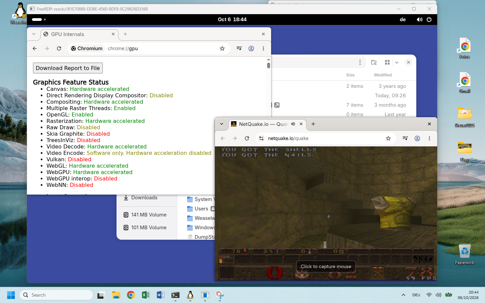

# Weaselway

[](https://github.com/weaselway/weaselway/releases)
[](https://github.com/weaselway/weaselway/actions/workflows/build-image.yml)
[](LICENSE)
[](https://discord.gg/6HG8ac8XWZ)

Weaselway runs a GPU-accelerated Linux desktop on WSL2 and shows it in a
window on Windows. The releases are NixOS-WSL images with GNOME or Plasma.
This README explains how to install, use and configure it.
[ARCHITECTURE.md](ARCHITECTURE.md) explains how it works.

https://github.com/user-attachments/assets/4867b0d8-d69e-49d9-93f8-eb8ae73222fd

The compositor runs unmodified. The `dxgdrm` kernel module gives it a virtual
display that it drives like a monitor through KMS (the kernel interface for
display output). Mesa's `d3d12` driver (which runs OpenGL and Vulkan on
Direct3D 12) renders on the GPU that Windows exposes to WSL. The `weaselwayd`
daemon reads each finished frame and passes it through shared memory to the
viewer, a Windows build of FreeRDP (an open-source Remote Desktop client).
Keyboard, mouse, touchpad and audio use the same connection.

Any Wayland compositor that can drive a display through KMS runs this way.
Besides GNOME and Plasma, sway, Weston, Hyprland and others start through a
session script you provide. See [Sessions](#sessions).

Each image contains the patched Mesa, the kernel module, weaselwayd, the audio
configuration and the viewer. You install nothing else, on Windows or in the
distro.

- [Quick start](#quick-start)
- [Requirements](#requirements)
- [Installation](#installation)
- [Using it](#using-it)
- [Sessions](#sessions)
- [Configuration](#configuration)
- [Updating](#updating)
- [Troubleshooting](#troubleshooting)
- [Limitations](#limitations)
- [Further reading](#further-reading)

## Quick start

Download an image from the
[latest release](https://github.com/weaselway/weaselway/releases/latest),
then import and start it in PowerShell:

```powershell
wsl --install --from-file nixos-weaselway-<desktop>-<version>.wsl --name Weaselway
wsl -d Weaselway
```

Inside the distro, start the desktop and open it in a window:

```sh
ww-start-session
ww-start-viewer
```

## Requirements

- Windows with WSL2, on an x86_64 machine. The image is x86_64 only.
- A GPU with a Windows driver that supports WSL GPU compute (the same driver
  that provides GPU access to other WSL distros).
- One of the WSL kernels `6.18.40.1-microsoft-standard-WSL2` (WSL 3.0.1),
  `6.18.54.1-microsoft-standard-WSL2` (WSL 3.0.3) or
  `6.18.58.1-microsoft-standard-WSL2` (WSL 3.0.5). The `dxgdrm` module is built
  for these kernel releases, and another release cannot load it. Check yours
  with `uname -r` inside any WSL distro. [Updating](#updating) explains what
  to do when WSL updates its kernel.
- WSLg enabled, which is the default. weaselwayd passes the frames through a
  shared memory region that WSL creates only for WSLg, so
  `guiApplications=false` in `%USERPROFILE%\.wslconfig` does not work.
- About 1.4 GiB of disk space for the image.
- For USB devices and Bluetooth only:
  [usbipd-win](https://github.com/dorssel/usbipd-win).

<!-- TODO(maintainer): add the minimum Windows build and WSL version that have
     been tested (the output of `wsl --version`), and a rough RAM figure. -->

## Installation

The release images are the quickest way in. To add weaselway to a NixOS-WSL
system you already have, see
[Into an existing NixOS-WSL system](#into-an-existing-nixos-wsl-system).
[ubuntu/README.md](ubuntu/README.md) installs it into an Ubuntu 26.04 distro
instead.

### From the image

1. Download `nixos-weaselway-gnome-<version>.wsl` or
   `nixos-weaselway-plasma-<version>.wsl` from the
   [latest release](https://github.com/weaselway/weaselway/releases/latest).
   The two differ only in the desktop they carry. Each CI run also uploads
   both as the artifacts `nixos-wsl-<desktop>-<commit>`, which are kept for a
   day. To build one yourself, see [Building](ARCHITECTURE.md#building).

2. Import it in PowerShell:

   ```powershell
   wsl --install --from-file nixos-weaselway-<desktop>-<version>.wsl --name Weaselway
   ```

3. Start the distro:

   ```powershell
   wsl -d Weaselway
   ```

   The shell runs as the user `nixos`, with the password `nixos`. The desktop
   asks for it on the lock screen; `sudo` does not ask for it. Change it with
   `passwd`.

[Using it](#using-it) continues from here.

### Into an existing NixOS-WSL system

The weaselway flake (a Nix project whose inputs are pinned in `flake.lock`)
provides a NixOS module. This flake adds it to a NixOS-WSL system. Pick one of
the three `nixpkgs` lines;
[nixpkgs and the binary cache](#nixpkgs-and-the-binary-cache) explains the
difference.

```nix
{
  inputs = {
    weaselway.url = "github:weaselway/weaselway";
    # Only for the third option below.
    nixpkgs.url = "github:NixOS/nixpkgs/nixos-unstable";
  };

  outputs =
    inputs@{ weaselway, ... }:
    let
      # weaselway's stable nixpkgs, everything cached:
      nixpkgs = weaselway.inputs.nixpkgs;
      # weaselway's nixos-unstable, everything cached:
      # nixpkgs = weaselway.inputs.nixpkgs-unstable;
      # your own: Mesa, mutter, KWin and what links them compile locally:
      # nixpkgs = inputs.nixpkgs;
    in
    {
      nixosConfigurations.nixos = nixpkgs.lib.nixosSystem {
        modules = [
          weaselway.inputs.nixos-wsl.nixosModules.default
          weaselway.nixosModules.weaselway
          ./configuration.nix
        ];
      };
    };
}
```

`configuration.nix` needs at least `wsl.enable = true;`,
`weaselway.enable = true;` and a desktop, for example
`services.desktopManager.gnome.enable = true;`. The image's
[configuration.nix](nix/image-gnome/configuration.nix) is a complete example.

### Uninstalling

In PowerShell:

```powershell
wsl --unregister Weaselway
```

Then delete the desktop shortcut if you installed it.

## Using it

### Start and stop the desktop

`ww-start-session` starts the desktop on the virtual display and returns when
it is running. `ww-start-session stop` stops it.

The distro keeps running for as long as the session does, also with no WSL
window open. Once the session is stopped, WSL stops the distro after 15
seconds.

### Open the viewer

`ww-start-viewer` opens the desktop in a window on Windows and returns. The
viewer keeps running and writes its log to
`/run/user/1000/weaselway-viewer.log`. `DEBUG=1 ww-start-viewer` runs it in
the foreground and prints the log on the terminal instead.

The viewer, `sdl-freerdp.exe`, runs from inside the image, so nothing is
installed on the Windows side. Closing its window does not end the session.
To reconnect, run `ww-start-viewer` again.



### Desktop shortcut

```sh
ww-install-viewer-link
```

This puts a shortcut named "Weaselway" on the Windows desktop;
`ww-install-viewer-link <name>` uses another name. The shortcut starts the
distro and the session if they are not running, then opens the viewer. A
minimized console window stays open next to the viewer and closes with it.

<!-- IMAGE (small): the "Weaselway" shortcut on the Windows desktop. -->

### Keyboard, touchpad and audio

The session sees an ordinary keyboard. Set the layout in the desktop's own
keyboard settings, not in the viewer.

The viewer forwards touchpad gestures with three or more fingers, audio
playback and the microphone. The session sees a touchpad of its own, so the
desktop's swipe and pinch gestures work.

<!-- VIDEO (short GIF, 5 s): a three-finger swipe opening the GNOME overview in
     the viewer. Touchpad gestures are unusual for a remote desktop and hard to
     explain in words. A screen recording of the trackpad is not needed, the
     desktop reacting is enough. -->

### USB devices and Bluetooth

usbipd-win shares USB devices from Windows with WSL. Its latest release,
5.3.0 from October 2025, does not work well with cameras. Install a newer
build from its
[Build workflow](https://github.com/dorssel/usbipd-win/actions/workflows/build-installer.yml?query=branch%3Amaster+is%3Asuccess)
instead: open the most recent run and download the artifact
`usbipd-win_<version>_x64.msi` (GitHub requires a login for this). Build
5.3.1 from there works with cameras. For
devices other than cameras, `winget install usbipd` installs the release.

Then share a device once, in a PowerShell with administrator rights:

```powershell
usbipd list
usbipd bind --busid <BUSID>
```

Sharing survives reboots. Attaching does not: `usbipd attach --wsl --busid
<BUSID>` connects the device until it is unplugged or WSL stops. Weaselway
loads `vhci_hcd` (the kernel's USB/IP client) at boot, which the attach needs.

To keep devices attached, list them in `weaselway.usbip.devices` by the
VID:PID that `usbipd list` shows:

```nix
weaselway.usbip.devices = [ "2357:0604" ];
```

A service then checks every second and attaches each listed device that is
shared but not attached, also after it is plugged in again. It runs only when
the list is not empty, and logs to `journalctl -u weaselway-usbipd-auto-attach`.

WSL's kernel has no rfkill (the kernel's switch for radios), and GNOME hides a
Bluetooth adapter without it. `weaselway.bluetooth.enable = true;` loads
Bluetooth modules rebuilt with rfkill in place of WSL's own, plus the firmware
for Realtek adapters. Common USB sticks with Realtek, Barrot, Actions or CSR
chips work.

The rebuilt modules have to load before WSL's own, so attach the adapter after
the distro started. An adapter in `weaselway.usbip.devices` is attached late
enough. If it was attached earlier, `systemctl status wsl-bluetooth-modules`
says so. Then run `wsl --shutdown`, start the distro and attach it again.

## Sessions

`ww-start-session [session]` accepts the following sessions. Without an
argument it starts the one set in `weaselway.session`: `gnome` in the GNOME
image and `plasma` in the Plasma image.

| Session | What it starts |
|---|---|
| `gnome` | The GNOME desktop, as a display manager would start it |
| `plasma` | The Plasma desktop |
| `custom` | Your compositor, through `custom-weaselway-session` |
| `gnome-shell` | GNOME Shell alone, for debugging |
| `kwin` | KWin with a terminal, for debugging |

<!-- IMAGE (three thumbnails in a row, same width): GNOME, Plasma and sway, each
     in its Windows window. Shows the "any compositor" claim, which is only text
     today. Put them right above or below this table. -->

The two debugging sessions leave out the services that `gnome-session` and
Plasma start (settings daemon, keyring, portals and so on). Much of the
desktop does not work in them.

### Other compositors

`ww-start-session custom` runs the executable `custom-weaselway-session` from
your `PATH`. It runs in the same logind session on the seat as the built-in
sessions, so the compositor it starts gets the display and the input devices.
The script sets the environment the compositor needs and ends by executing
it:

```nix
environment.systemPackages = [
  pkgs.sway
  (pkgs.writeShellScriptBin "custom-weaselway-session" ''
    export XDG_CURRENT_DESKTOP=sway
    exec sway "$@"
  '')
];
```

[examples/custom-weaselway-session](examples/custom-weaselway-session) does
the same for sway without a rebuild. Its `nix-shell` shebang fetches sway when
the session starts.

To make a custom session the default, set `weaselway.session = "custom"`.

niri needs one setting for weaselway: the GPU to render on. `card0` belongs
to WSL's vgem (a virtual graphics device that cannot render), so point niri
at dxgdrm's render node instead. This configuration builds niri's default
config with that setting added:

```nix
environment.systemPackages =
  let
    niriConfig = pkgs.runCommand "niri-config.kdl" { } ''
      cat ${pkgs.niri.src}/resources/default-config.kdl - > $out <<'EOF'
      debug {
          render-drm-device "/dev/dri/by-path/platform-dxgdrm-render"
      }
      EOF
    '';
  in
  [
    pkgs.niri
    pkgs.alacritty # Super+T in niri's default config
    pkgs.fuzzel # Super+D
    pkgs.waybar # started by the default config
    (pkgs.writeShellScriptBin "custom-weaselway-session" ''
      export XDG_CURRENT_DESKTOP=niri
      exec niri --config ${niriConfig} "$@"
    '')
  ];
```

To keep the config in your home directory instead, copy niri's
[default config](https://github.com/YaLTeR/niri/blob/main/resources/default-config.kdl)
to `~/.config/niri/config.kdl`, add the `debug` block, and drop `--config`.

niri 26.04 was tested with this config on the GNOME image: the viewer shows
niri, the clipboard works, and niri follows the size of the viewer window.
Keyboard, mouse, audio and X11 apps have not been tested.

## Configuration

### Changing the system

The image ships its own NixOS configuration as a flake in `/etc/nixos`:

- `flake.nix` takes weaselway (`github:weaselway/weaselway`) as an input, and
  with it the matching nixpkgs and NixOS-WSL.
- `configuration.nix` is the system configuration, the same file the image
  was built from
  ([nix/image-gnome/configuration.nix](nix/image-gnome/configuration.nix) or
  [nix/image-plasma/configuration.nix](nix/image-plasma/configuration.nix)).
  It also selects the desktop.

To change the system, edit `configuration.nix` and rebuild:

```sh
sudo -e /etc/nixos/configuration.nix
sudo nixos-rebuild switch
```

The hostname is `nixos`, so `nixos-rebuild` selects
`nixosConfigurations.nixos` without a `#name` argument.

Everything else is standard NixOS: add packages to
`environment.systemPackages`, set `time.timeZone` and so on. The image
deviates from the NixOS defaults in two places:

- sshd is disabled. To log in over SSH, uncomment `services.openssh.enable`,
  and change the password with `passwd` or add a key first. With mirrored WSL
  networking the distro is reachable from the LAN.
- The screen reader is not installed, because Orca's voices add about 650 MB.
  To install it, delete the two lines marked in `configuration.nix`.

### Options

| Option | Default | Sets |
|---|---|---|
| `weaselway.enable` | `false`, `true` in the image | Mesa, dxgdrm, weaselwayd, audio and the scripts |
| `weaselway.adapter` | `null` | The GPU to render on |
| `weaselway.session` | `"gnome"` | The default session |
| `weaselway.bluetooth.enable` | `false` | Bluetooth modules with rfkill |
| `weaselway.usbip.devices` | `[ ]` | USB devices to keep attached |

- **`weaselway.adapter`** matches a part of the GPU's name, for example
  `"nvidia"` or `"Intel"`. `null` selects the first adapter Windows lists.
  `ww-start-session --adapter <name>` overrides it for one session without a
  rebuild.
- **`weaselway.session`** is the session `ww-start-session` starts when given
  none, one of those under [Sessions](#sessions).
- **`weaselway.bluetooth.enable`** and **`weaselway.usbip.devices`** are
  described under [USB devices and Bluetooth](#usb-devices-and-bluetooth).
  The service behind `weaselway.usbip.devices` expects usbipd-win in its
  default location, `C:\Program Files\usbipd-win`.

### Viewer options

`ww-start-viewer` appends its arguments to the `sdl-freerdp.exe` command line,
so any FreeRDP option can be added or overridden for one run.

To run a different build of the viewer, set `WEASELWAY_VIEWER`:

```sh
WEASELWAY_VIEWER=/mnt/c/Weaselway/sdl-freerdp.exe ww-start-viewer
```

### nixpkgs and the binary cache

The image runs on the stable NixOS release. weaselway's lock also pins
nixos-unstable. CI builds both and pushes the results to
[weaselway.cachix.org](https://weaselway.cachix.org), a binary cache (a server
with prebuilt packages) that the image is configured to use. Both are updated
weekly, the stable one on Fridays and unstable on Saturdays, and CI commits a
new lock only after it has built it.

To switch the image to unstable, change this line in `/etc/nixos/flake.nix`
and rebuild:

```nix
nixosConfigurations.nixos = weaselway.inputs.nixpkgs-unstable.lib.nixosSystem {
```

A flake of your own selects nixpkgs the same way, see
[Into an existing NixOS-WSL system](#into-an-existing-nixos-wsl-system).

Some packages are not on cache.nixos.org: the patched Mesa and mutter,
gnome-shell (which links mutter), weaselwayd and the kernel tree dxgdrm is
built against. A configuration change that alters one of them compiles it
locally, which takes time and a few GB of disk space. Weaselway also patches
KWin, so enabling Plasma downloads KWin and the packages that depend on it
from the cache, or compiles them if CI has not built that combination.

The viewer and NixOS-WSL always come from weaselway's stable nixpkgs,
whichever one the system uses, so they stay cached. The kernel modules are
built with a nixpkgs pinned in
[wsl-kernel](https://github.com/weaselway/wsl-kernel). Do not set
`inputs.weaselway.inputs.nixpkgs.follows`: it would move the viewer and
NixOS-WSL to your nixpkgs as well, and then the viewer's mingw toolchain (the
compiler for Windows programs) compiles on your machine.

## Updating

`/etc/nixos/flake.lock` pins weaselway to the commit the image was built from,
so a rebuild after a configuration change updates nothing. To update, move
the lock forward and rebuild:

```sh
sudo nix flake update --flake /etc/nixos
sudo nixos-rebuild switch
```

This updates weaselway together with nixpkgs, NixOS-WSL, Mesa, the kernel
module, weaselwayd and the viewer, to versions that were built and tested
together.

After a rebuild, restart the session so that it uses the new Mesa:
`ww-start-session stop`, then `ww-start-session`. If the kernel module
changed, run `wsl --shutdown` instead.

To undo an update, switch back to the previous generation (the system build
NixOS kept from before the update):

```sh
sudo nixos-rebuild switch --rollback
```

`wsl --update` can install a WSL kernel that no Weaselway release supports
yet. The module is then missing, and no session starts until a release adds
that kernel, because each kernel needs its own build of `dxgdrm` with the
kernel's configuration and compiler. While you rely on Weaselway, hold off on
`wsl --update` until a release lists the new kernel under
[Requirements](#requirements).

## Troubleshooting

### The viewer window stays empty or closes immediately

Check `journalctl --user -u weaselwayd`. The message "waiting for the
compositor's first commit" means that no session is running; start one with
`ww-start-session`.

weaselwayd does not start without the shared memory region, and
`systemctl status weaselway-prep` reports why it is missing. Check that
`.wslconfig` does not contain `guiApplications=false`, and that you ran
`wsl --shutdown` after changing it.

### `ww-start-session` fails

`journalctl -u weaselway-session` contains the compositor's output.

If `systemctl status weaselway-prep` says that the dxgdrm module is missing for
this WSL kernel, `uname -r` differs from the kernels the release was built
for. This usually follows a `wsl --update`, see [Updating](#updating).

### The desktop shows no audio devices

`wpctl status` should list "Remote Desktop Audio", and
`/run/user/1000/pulse/native` should be a socket, not a symbolic link.

### The picture is wrong or slow

Two viewer options help with display problems. They can be combined.

```sh
ww-start-viewer /sdl-show-stats:2   # frame and bandwidth counters, text at 2x
ww-start-viewer /sdl-show-damage    # tint the regions updated in each frame
```

The value after `/sdl-show-stats` is the text scale and is optional.

<!-- IMAGE + VIDEO: (1) a screenshot of a 2560x1440 session with the
     /sdl-show-stats overlay showing 60 fps, with the GPU named in the caption.
     That backs the performance claim on the profile page with numbers.
     (2) a short GIF of /sdl-show-damage while scrolling a page or moving a
     window: only the tinted rectangles are updated, which shows why the
     transfer is cheap. -->

[Debugging](ARCHITECTURE.md#debugging) in ARCHITECTURE.md lists further checks.

## Limitations

- Weaselway supports only the WSL kernel releases listed under
  [Requirements](#requirements). See [Updating](#updating) for `wsl --update`.
- The scale factor of the Windows display is not passed on. Set the scale in
  the desktop's display settings.
- Touchscreens are not forwarded. Touchpad gestures are.
- The viewer works only in the Windows session that started WSL. If WSL was
  started over SSH, from Remote Desktop or by a scheduled task,
  `ww-start-viewer` says so. Then run `wsl --shutdown` and start the distro
  from the desktop.
- Compositors other than GNOME and Plasma have seen little testing. If one
  does not start on the virtual display, please open an issue.

[Known issues](ARCHITECTURE.md#known-issues) in ARCHITECTURE.md has the
details.

## Further reading

- [ARCHITECTURE.md](ARCHITECTURE.md) describes how the parts fit together,
  [how to build](ARCHITECTURE.md#building) the images and
  [how to debug](ARCHITECTURE.md#debugging) them.
- [docs/adr](docs/adr) holds the architecture decision records, one file per
  design decision with its reasons.
- [CHANGELOG.md](CHANGELOG.md) lists the changes in each release.
- [ubuntu/README.md](ubuntu/README.md) installs weaselway on Ubuntu instead of
  NixOS.

## A note on AI

AI was used heavily throughout this project. This is not meant to be a
beautiful piece of software. It is meant to solve a problem I have: I want
to be able to use GNOME on my Windows machine.
